# Evidex — An Agentic AI Research Investigation Platform

> **Investigate the evidence behind research.**  
> Compare research papers, trace claims to source passages, and discover where findings agree, differ, or remain uncertain.

---

## 1. Project Overview

**Evidex** is a production-quality, agentic AI research investigation platform that enables scientists, clinical researchers, and machine learning practitioners to investigate empirical claims across multiple academic papers simultaneously. 

Unlike traditional PDF chatbots that generate conversational summaries prone to hallucination, Evidex operates on a foundational principle: **Evidence before conclusions**. Every factual conclusion in an investigation report is linked to an exact, verifiable passage extracted from the original PDF with page-number fidelity.

---

## 2. Problem Statement

Modern scientific literature suffers from significant fragmentation:
1. **Uncalibrated AI Hallucinations**: Standard LLM tools frequently invent citations, author lists, experimental numbers, and p-values when asked comparative research questions.
2. **Missing Ground Truth Context**: A claim like *"our technique improved accuracy by 5.8%"* is often separated from its crucial boundary condition (*"only under low-data regimes; plateaued under 50% labels"*).
3. **Manual Cross-Document Synthesis**: Synthesizing methodology differences, metric discrepancies, and domain shifts across multiple papers is painstakingly slow.

Evidex automates this investigation pipeline without sacrificing scientific veracity.

---

## 3. Key Features

- **Page-Preserving PDF Parsing**: Uses PyMuPDF to extract text page-by-page while tracking exact chunk coordinates and character offsets.
- **Robust Paper Metadata Extraction**: Inspects layout blocks, font sizes, and arXiv identifiers to identify genuine paper titles, authors, and publication years, strictly ignoring conference headers (e.g. "Published as a conference paper at ICLR").
- **Topical Relevance Ranking**: Evaluates how each paper aligns with the inquiry using BM25 lexical and semantic hit analysis, providing clear explanations of query overlap.
- **Fine-Grained Claim Extraction**: Distinguishes author-reported empirical findings from background commentary and experimental setup details.
- **Verifiable Evidence Grounding**: Every claim retrieves exact supporting, qualifying, or conflicting passages from the document store.
- **Independent Reference Validity vs Semantic Support**: Strictly separates whether a cited passage actually exists in the paper (`Reference verified`) from whether it semantically affirms the claim (`Support confirmed`, `Partially supported`, `Contradicted`, `Unsupported`).
- **Ungrounded Disagreement Prevention**: Strictly rejects unsupported domain claims (e.g. cross-center clinical claims on vision architectures) and reports honest uncertainty ("No verified disagreement identified").
- **Source Passage Context Modal**: Inspect the full page context of any cited passage with a single click.
- **Cross-Paper Comparison Matrix**: Side-by-side mapping of research objectives, methodologies, datasets, evaluation metrics, and reported results.
- **Automated Citation Auditing**: Runs strict character and n-gram validation on every cited passage against stored document text before report finalization.
- **Structured Report Generation**: Compiles publication-ready reports with instant Markdown export and clipboard copying.
- **Pre-Seeded Research Benchmarks**: Pre-loaded with Vision Transformer, ResNet, and DenseNet foundational papers for immediate evaluation.

---

## 4. Why an Agentic AI Workflow?

A single, unrestricted prompt cannot reliably perform multi-paper research synthesis because:
- **Context Overload & Bias**: Packing multiple 20-page papers into a single prompt causes attention degradation and misses subtle contradictions.
- **Hallucinated Citations**: LLMs easily fabricate quotations when tasked with simultaneous reasoning and extraction.
- **Lack of Verification**: A monolithic prompt cannot verify whether a cited page actually exists in the source PDF.

### The Evidex Solution: Deterministic Tools + Orchestrator
Evidex implements a **Research Orchestrator Agent** that controls 12 specialized deterministic Python tools. The language model reasons over structured evidence retrieved by deterministic tools rather than inventing the evidence itself. If external AI APIs encounter rate limits or network failures, Evidex falls back seamlessly to its deterministic extraction pipeline.

---

## 5. System Architecture

```mermaid
flowchart TD
    subgraph Client ["Frontend (React + Vite + Tailwind CSS)"]
        UI["Minimal White Interface"]
        OV["Overview & Stats"]
        INV["New Investigation"]
        RES["5-Tab Results Workspace"]
        MOD["Passage Context Viewer"]
    end

    subgraph Server ["Backend (FastAPI + Python 3.11)"]
        API["REST API Router (/api)"]
        PDF["PyMuPDF PDF Parser"]
        RET["BM25 Document Retriever"]
        DAO["SQLite DAO Engine"]
    end

    subgraph AgenticCore ["Agentic Orchestration Engine"]
        ORCH["Research Orchestrator Agent"]
        T1["Tool 1: extract_paper_metadata"]
        T2["Tool 2: rank_paper_relevance"]
        T3["Tool 3: search_document_chunks"]
        T4["Tool 4: extract_claims"]
        T5["Tool 5: find_supporting_evidence"]
        T6["Tool 6: find_counterevidence"]
        T7["Tool 7: compare_methodologies"]
        T8["Tool 8: compare_paper_findings"]
        T9["Tool 9: get_page_text"]
        T10["Tool 10: validate_evidence_reference"]
        T11["Tool 11: check_claim_support"]
        T12["Tool 12: validate_disagreements"]
    end

    subgraph AI ["AI Intelligence Layer"]
        GEMINI["Gemini 2.0 / 3.8 Flash (Tool Calling & Synthesis)"]
        FALLBACK["Deterministic Fallback Engine"]
    end

    subgraph Storage ["Persistent Storage"]
        DB[(SQLite database: evidex.db)]
        FS[(Local PDF uploads/ directory)]
    end

    UI --> API
    API --> DAO
    API --> PDF
    PDF --> FS
    PDF --> DAO
    API --> ORCH
    ORCH --> T1 & T2 & T3 & T4 & T5 & T6 & T7 & T8 & T9 & T10 & T11 & T12
    T2 & T3 & T5 & T6 --> RET
    T10 & T12 --> DAO
    ORCH --> GEMINI
    GEMINI -.-> FALLBACK
    DAO --> DB
    RES --> MOD
```



---

## 6. Technology Stack

### Frontend
- **Framework**: React 19 + TypeScript
- **Build Tool**: Vite 8
- **Styling**: Tailwind CSS v4 (Tailwind tokens, CSS variables, Linear/Notion minimal white aesthetic)
- **Icons**: Lucide React
- **Routing**: React Router DOM v7

### Backend
- **Framework**: FastAPI (Asynchronous Python REST API)
- **Data Validation**: Pydantic v2 & Pydantic-Settings
- **PDF Extraction**: PyMuPDF (`fitz`) for coordinate-aware page parsing
- **AI SDK**: Google GenAI SDK (`google-genai`)
- **Database**: SQLite3 with WAL mode and custom transaction DAO
- **Testing**: Pytest + Pytest-Asyncio + Pytest-Mock (16 automated tests)

---

## 7. Repository Structure

```
evidex/
├── docker-compose.yml               # Multi-container orchestration (backend + frontend nginx)
├── backend/
│   ├── Dockerfile                   # Python 3.11-slim production container
│   ├── app/
│   │   ├── main.py                  # FastAPI lifespan, CORS, and app entrypoint
│   │   ├── api/
│   │   │   └── router.py            # Complete REST routes (/papers, /investigations, /sample)
│   │   ├── core/
│   │   │   ├── config.py            # Environment settings and paths
│   │   │   └── logging.py           # Content-safe logging configuration
│   │   ├── db/
│   │   │   └── database.py          # SQLite DAO schema, tables, and CRUD operations
│   │   ├── schemas/
│   │   │   └── schemas.py           # Pydantic data models and API response types
│   │   ├── services/
│   │   │   ├── pdf_service.py       # PyMuPDF page extraction, chunking, and metadata
│   │   │   ├── retrieval.py         # BM25 per-paper indexer and passage validation
│   │   │   └── sample_service.py    # Grounded sample PDF generation & benchmark seeder
│   │   ├── tools/
│   │   │   └── research_tools.py    # The 12 specialized research tools
│   │   └── agents/
│   │       └── orchestrator.py      # 8-stage Research Orchestrator agent pipeline
│   ├── tests/
│   │   ├── test_backend.py          # 9 automated tests for core pipelines
│   │   └── test_accuracy_audit.py   # 7 regression tests for metadata, validity, and grounding
│   ├── uploads/                     # Uploaded documents and benchmark PDFs
│   ├── pytest.ini                   # Pytest configuration
│   ├── requirements.txt             # Verified backend dependencies
│   └── .env.example                 # Environment configuration template
├── frontend/
│   ├── Dockerfile                   # Multi-stage production container with Nginx
│   ├── nginx.conf                   # Reverse proxy configuration for SPA + /api/
│   ├── src/
│   │   ├── components/
│   │   │   ├── Sidebar.tsx          # Collapsible navigation sidebar
│   │   │   ├── Header.tsx           # Breadcrumb and quick-action top bar
│   │   │   ├── EvidenceBadge.tsx    # Relationship and reference status indicators
│   │   │   ├── PassageViewerModal.tsx# Source document page and quotation inspector
│   │   │   └── EmptyState.tsx       # Reusable empty states
│   │   ├── pages/
│   │   │   ├── OverviewPage.tsx     # Landing overview with metrics & recent runs
│   │   │   ├── NewInvestigationPage.tsx # Inquiry input, file dropzone & live stage tracker
│   │   │   ├── InvestigationResultsPage.tsx # 5-tab scientific results workspace
│   │   │   ├── LibraryPage.tsx      # Document library and page text viewer
│   │   │   ├── InvestigationsPage.tsx # Investigation history log
│   │   │   ├── ReportsPage.tsx      # Finalized reports and Markdown export
│   │   │   └── SettingsPage.tsx     # System health and AI engine diagnostics
│   │   ├── services/
│   │   │   └── api.ts               # Type-safe API client
│   │   ├── types/
│   │   │   └── index.ts             # TypeScript interfaces
│   │   ├── App.tsx                  # Main layout and route tree
│   │   ├── main.tsx                 # React DOM mount point
│   │   └── index.css                # Minimal white design tokens & custom styling
│   ├── package.json
│   ├── tsconfig.json
│   └── vite.config.ts
├── .gitignore
├── .env.example
└── README.md
```

---

## 8. Quick Start: Local Development

### Prerequisites
- Python 3.10+
- Node.js 18+ and npm
- Git

### 1. Configure & Run Backend
```bash
cd backend
python3 -m pip install -r requirements.txt
cp .env.example .env
python3 -m uvicorn app.main:app --host 127.0.0.1 --port 8000 --reload
```
Interactive API docs: `http://127.0.0.1:8000/docs`.

### 2. Configure & Run Frontend
In a new terminal:
```bash
cd frontend
npm install
npm run dev
```
Open `http://localhost:5173` in your browser.

---

## 9. Automated Test Suite

Run the full 16-test suite:
```bash
cd backend
python3 -m pytest -v
```

Tests cover:
- ViT title extraction excluding ICLR conference headers
- DenseNet CVPR 2017 publication resolution
- ResNet author parsing excluding email strings
- Rejection of unsupported clinical claims on vision papers
- Separation of reference validity from semantic evidence support
- Reclassification of dataset differences as non-contradictory
- Explicit uncertainty labeling for unmentioned metrics
- Core health, PDF ingestion, chunking, retrieval, and report generation

---

## 10. Deployment Guide

### Option A: One-Command Docker Compose (Recommended)
Evidex includes a multi-container Docker Compose configuration with an Nginx reverse proxy:

```bash
# 1. Provide Gemini API Key (optional)
export GEMINI_API_KEY="your_api_key_here"

# 2. Build and launch containers
docker compose up --build -d
```
- **Web UI**: `http://localhost:3000`
- **Backend API**: `http://localhost:8000`
- In Docker mode, Nginx automatically proxies all `/api/` calls to the backend container.

To stop the containers:
```bash
docker compose down
```

---

### Option B: Cloud Split Deployment

#### 1. Frontend (Vercel / Cloudflare Pages / Netlify)
- **Root Directory**: `frontend`
- **Build Command**: `npm run build`
- **Output Directory**: `dist`
- **Environment Variable**:
  ```env
  VITE_API_BASE_URL=https://api.your-domain.com/api
  ```

#### 2. Backend (Render / Railway / Fly.io / GCP Cloud Run)
- **Root Directory**: `backend` (or build using `backend/Dockerfile`)
- **Environment Variables**:
  ```env
  GEMINI_API_KEY=your_gemini_api_key
  GEMINI_MODEL=gemini-3.8-flash
  DATABASE_URL=sqlite:////app/evidex.db
  UPLOAD_DIR=/app/uploads
  CORS_ORIGINS=["https://your-domain.com", "http://localhost:3000"]
  ```
- **Start Command**:
  ```bash
  uvicorn app.main:app --host 0.0.0.0 --port $PORT
  ```

---

## 11. API Endpoints Reference

| Method | Endpoint | Description |
|---|---|---|
| `GET` | `/api/health` | Health status, version, and indexed counts |
| `POST` | `/api/papers/upload` | Upload research PDF (multipart/form-data) |
| `GET` | `/api/papers` | List all indexed papers |
| `GET` | `/api/papers/{paper_id}` | Get paper metadata and processing state |
| `GET` | `/api/papers/{paper_id}/page/{page_number}` | Fetch raw extracted page text |
| `DELETE` | `/api/papers/{paper_id}` | Delete paper, chunks, and disk storage |
| `POST` | `/api/investigations` | Start new investigation across papers |
| `GET` | `/api/investigations` | List investigation history |
| `GET` | `/api/investigations/{id}` | Get full investigation with claims, evidence, and report |
| `GET` | `/api/investigations/{id}/status` | Poll execution stage and progress (0-100%) |
| `GET` | `/api/investigations/{id}/claims` | Retrieve extracted claims |
| `GET` | `/api/investigations/{id}/evidence` | Retrieve grounded evidence passages |
| `GET` | `/api/investigations/{id}/comparison` | Retrieve cross-paper comparison table |
| `GET` | `/api/investigations/{id}/report` | Retrieve validated research report |
| `POST` | `/api/investigations/{id}/rerun` | Re-execute an investigation |
| `GET` | `/api/sample` | Seed and return the benchmark sample investigation |

---

## 12. License

MIT License. Designed and engineered for transparent scientific research.
